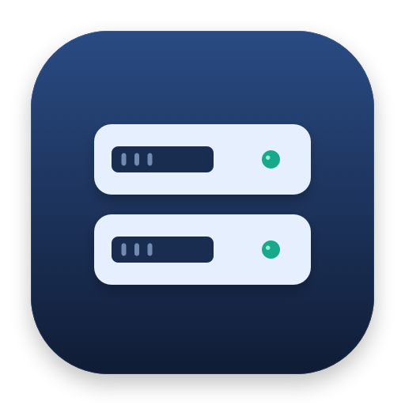

<p align="center">
  
</p>

# Dev Servers

See what's running. Stop what you're done with. Restart it when you need it.

A small macOS menu bar app for local development servers. It groups processes by project and worktree, shows their ports, CPU and memory, and lets you stop a server together with its launcher and children.

Native SwiftUI interface. Python standard library backend. No account, cloud service or telemetry.

[Español](docs/README.es.md) · [Report a bug](https://github.com/jjprietor/dev-servers/issues)

## Install

Requires **macOS 14 or later**, **Python 3.9 or later**, and the **Xcode Command Line Tools**. The app interface is currently in Spanish.

```sh
# Install Apple's build tools if needed:
xcode-select --install

git clone https://github.com/jjprietor/dev-servers.git
cd dev-servers
./install.sh
```

The installer compiles for your Mac, installs `~/Applications/Dev Servers.app`, and opens it. Look for the server icon in the menu bar. To also launch at login, use `./install.sh --login`.

To update:

```sh
git pull --ff-only
./install.sh
```

Building locally uses an ad hoc signature. The project does not currently provide an Apple-notarized download.

## Use

| Action | Where |
| --- | --- |
| Stop a server | Stop button in its row |
| Restart it | Play button under **Detenidos recientemente** |
| Open a known web server or its folder | Hover over the row |
| Copy command or PID | Right-click the row |
| Review servers running for over 48 hours | **Revisar antiguos** in the footer |
| Inspect a possible orphan | **Posibles huérfanos**; stopping requires confirmation |
| Inspect restart output | **Ver log** on a stopped entry after a failed restart |

The list refreshes when you open the panel and every 30 seconds. Orange means over 48 hours old; red means the process tree is using at least 100% CPU (approximately one core). Neither implies a server is safe to stop.

## Stopping and restarting

- Detection covers TCP listeners owned by your user, excluding executables in common system and application directories. Review the command and folder before stopping an unfamiliar process.
- Recognized launchers such as npm and pnpm are included when stopping a server. Ordinary Node and Python parent processes are not treated as launchers.
- Ordinary servers receive `SIGTERM`, then `SIGKILL` after five seconds if needed. Process start times are checked before signalling to reduce the risk of acting on a reused PID.
- PostgreSQL is stopped only through its matching `pg_ctl stop -m fast`. If its data directory cannot be determined or `pg_ctl` fails, the operation reports an error. It never falls back to a forced kill.
- Bulk cleanup shows its target list and excludes PostgreSQL and possible orphans. A process without a listening port may be a valid worker or background job.
- Restart uses the saved command, working directory and environment. It refuses to restart if a recorded port is already listening or the directory no longer exists.

## Command line

```sh
./devservers.py list          # servers and possible orphans
./devservers.py json          # state for the app; excludes saved environment values
./devservers.py stop <pid>    # stop and save for restart
./devservers.py start <id>    # restart a saved entry
./devservers.py forget <id>   # remove a saved entry
./devservers.py clean         # review and stop old servers; excludes PostgreSQL
```

CLI errors return a nonzero exit status. `clean --yes` skips confirmation; use it only when you intend to stop all eligible old servers.

## Local data

Restart information lives in `~/.devservers/stopped.json`. **It includes environment variables, which may contain API keys and database credentials.** State directories use mode `700`; history, lock files and restart logs use `600`. History writes are atomic, and mutations are serialized across app and CLI processes.

Removing an entry deletes its saved environment from the history. Logs remain until removed manually or with `./uninstall.sh --purge`; they can also contain sensitive application output. Do not attach your state directory to bug reports.

## Configuration

| Environment variable | Purpose |
| --- | --- |
| `DEVSERVERS_HOME` | State directory; defaults to `~/.devservers` |
| `DEVSERVERS_PYTHON` | Python executable used by the app |
| `DEVSERVERS_SCRIPT` | Alternative backend script, useful during development |

GUI apps do not inherit your terminal's environment. To use overrides, launch the executable from that terminal. Age and CPU thresholds are constants near the top of `devservers.py`.

## Limitations

- macOS only; no root services or Docker container management.
- Any eligible TCP listener can appear, including non-development services outside the excluded directories. There is no automatic proof that a process is disposable.
- npm and other tools may rewrite their process titles. Reconstructed commands can lose quoting, and environment recovery can be incomplete. Restart is best effort.
- A restart is reported after the process remains alive for two seconds. This is not an application health check.
- The app does not manage logins, supervise restarted servers, rotate logs, or automatically update itself.

## Development

```sh
python3 -m unittest discover -s tests -v
DEVSERVERS_INTEGRATION=1 python3 -m unittest discover -s tests -v
./build.sh
```

The integration test starts a temporary HTTP server, discovers it, stops it, and verifies that restarting preserves its port, environment and working directory. It only targets its own fixture processes. CI runs tests and verifies a compiled app bundle on macOS.

The UI is in `app/DevServers.swift`; discovery and lifecycle operations are in `devservers.py`. `build.sh` builds without installing or launching the app. See [CONTRIBUTING.md](CONTRIBUTING.md) for the development workflow.

## Uninstall

```sh
./uninstall.sh           # remove app and login item; keep history and logs
./uninstall.sh --purge   # also remove known state files and restart logs
```

Uninstalling does not stop your development servers.

## License

[MIT](LICENSE)
